# Architecture & Flow Diagrams

> **SYNTHETIC DEMO — NOT A REAL BANKING SYSTEM.**
> All banks, customers, accounts, amounts, services, metrics and logs are fictional.

## Table of contents

1. [System architecture](#1-system-architecture)
2. [Request flow](#2-request-flow)
3. [Investigation workflow (LangGraph state machine)](#3-investigation-workflow-langgraph-state-machine)
4. [Governed RAG pipeline](#4-governed-rag-pipeline)
5. [Action execution with approval](#5-action-execution-with-approval)
6. [Audit hash chain](#6-audit-hash-chain)
7. [Authentication & authorization flow](#7-authentication--authorization-flow)
8. [Evaluation & release gate](#8-evaluation--release-gate)
9. [Data model (ERD)](#9-data-model-erd)
10. [Deployment topology](#10-deployment-topology)

---

## 1. System architecture

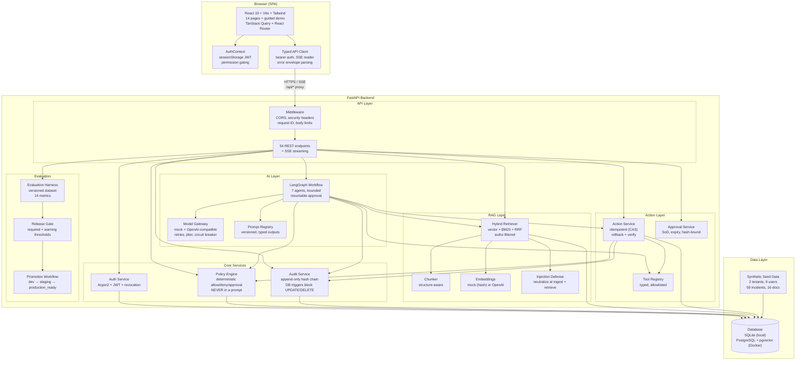

### Key design principle

```
┌──────────────────────────────────────────────────────────────┐
│  THE LLM IS NEVER THE AUTHORIZATION BOUNDARY                  │
│                                                              │
│  Model proposes ──► Policy Engine disposes                   │
│                                                              │
│  ┌──────────┐     ┌──────────────┐     ┌───────────────┐    │
│  │  LLM     │     │ Policy Engine│     │  Audit Log    │    │
│  │ proposes │────►│ decides      │────►│  records      │    │
│  │ actions  │     │ allow/deny/  │     │  every        │    │
│  │          │     │ approval     │     │  decision     │    │
│  └──────────┘     └──────────────┘     └───────────────┘    │
│       │                   │                                  │
│       ▼                   ▼                                  │
│  ┌──────────┐     ┌──────────────┐                          │
│  │ Pydantic │     │ Tool Registry│                          │
│  │ validates│     │ allowlisted  │                          │
│  │ output   │     │ typed params │                          │
│  └──────────┘     └──────────────┘                          │
│                                                              │
│  Even if the model is fully compromised via prompt injection,│
│  it CANNOT execute unauthorized actions.                    │
└──────────────────────────────────────────────────────────────┘
```

---

## 2. Request flow

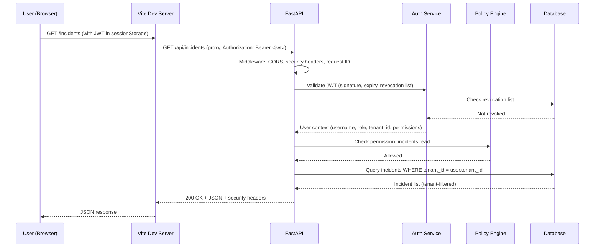

### SSE (Server-Sent Events) flow for live investigation updates

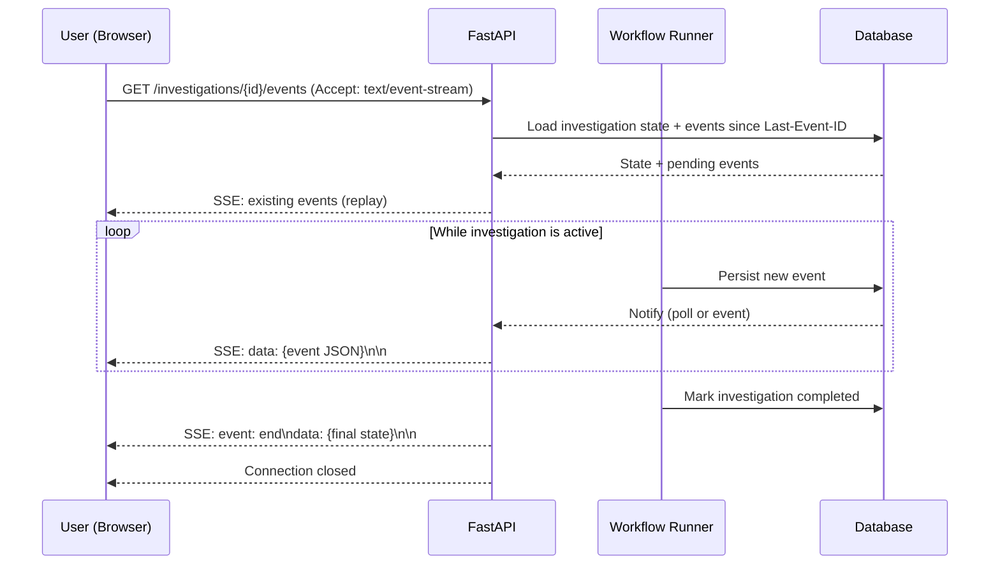

---

## 3. Investigation workflow (LangGraph state machine)

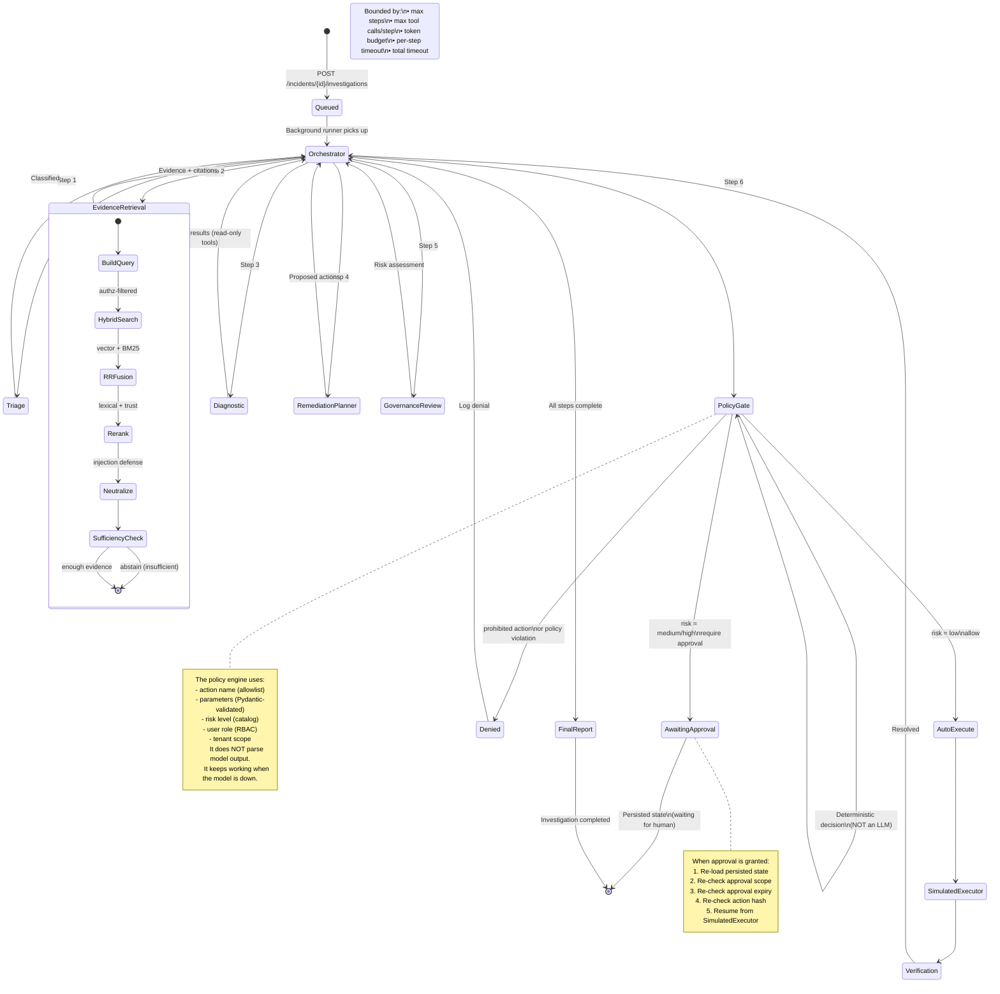

### Workflow bounds and degraded mode

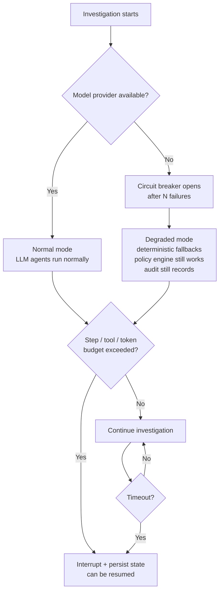

---

## 4. Governed RAG pipeline

```mermaid
flowchart LR
    subgraph Ingestion["Ingestion (admin/manager only)"]
        Upload[Upload document<br/>md, txt, pdf]
        Scan1[Scan for injection<br/>neutralize + flag]
        Chunk[Structure-aware<br/>chunking]
        Hash[Content hash<br/>deduplication]
        Embed[Generate embeddings<br/>mock or OpenAI]
        Store[Store in vector DB<br/>pgvector or SQLite]
        Upload --> Scan1 --> Chunk --> Hash --> Embed --> Store
    end

    subgraph Retrieval["Retrieval (authorized users)"]
        Query[User query]
        AuthzFilter[Authorization filters<br/>tenant_id<br/>classification ≤ clearance<br/>role in allowed_roles]
        VectorSearch[Vector search<br/>cosine similarity]
        BM25Search[BM25 keyword<br/>term frequency]
        RRF[Reciprocal Rank Fusion<br/>combine rankings]
        Rerank[Lexical reranking<br/>+ source-trust weighting<br/>unverified down-ranked]
        Scan2[Scan for injection<br/>neutralize at retrieval]
        Sufficient{Sufficient<br/>evidence?}
        Results[Results with citations<br/>section path + chunk hash]
        Abstain[Abstain<br/>do not hallucinate]
        
        Query --> AuthzFilter
        AuthzFilter --> VectorSearch
        AuthzFilter --> BM25Search
        VectorSearch --> RRF
        BM25Search --> RRF
        RRF --> Rerank
        Rerank --> Scan2
        Scan2 --> Sufficient
        Sufficient -->|"Yes"| Results
        Sufficient -->|"No"| Abstain
    end

    Store -.->|"indexed chunks"| VectorSearch
    Store -.->|"chunk text"| BM25Search
```

### Authorization filtering (before ranking, not after)

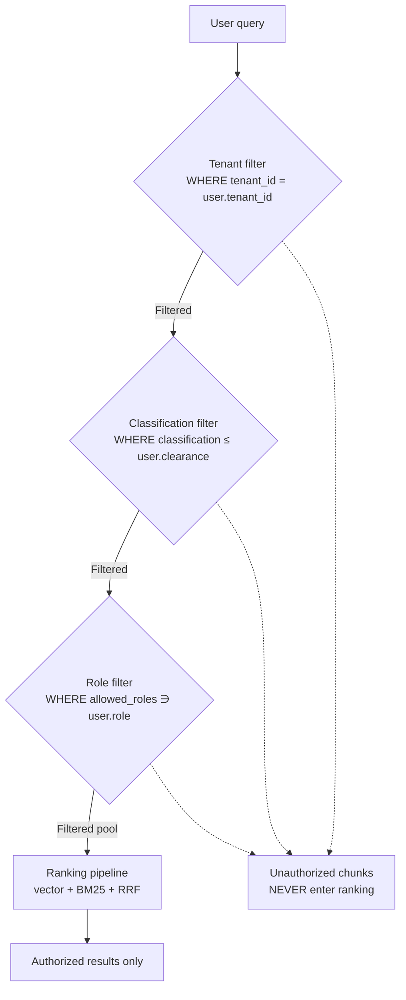

---

## 5. Action execution with approval

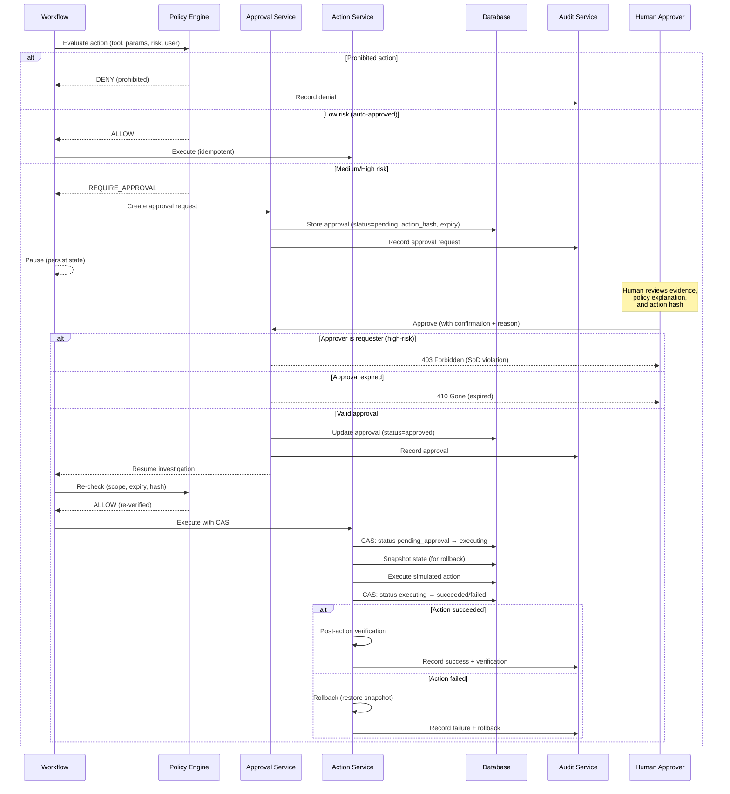

### Idempotency via Compare-And-Swap (CAS)

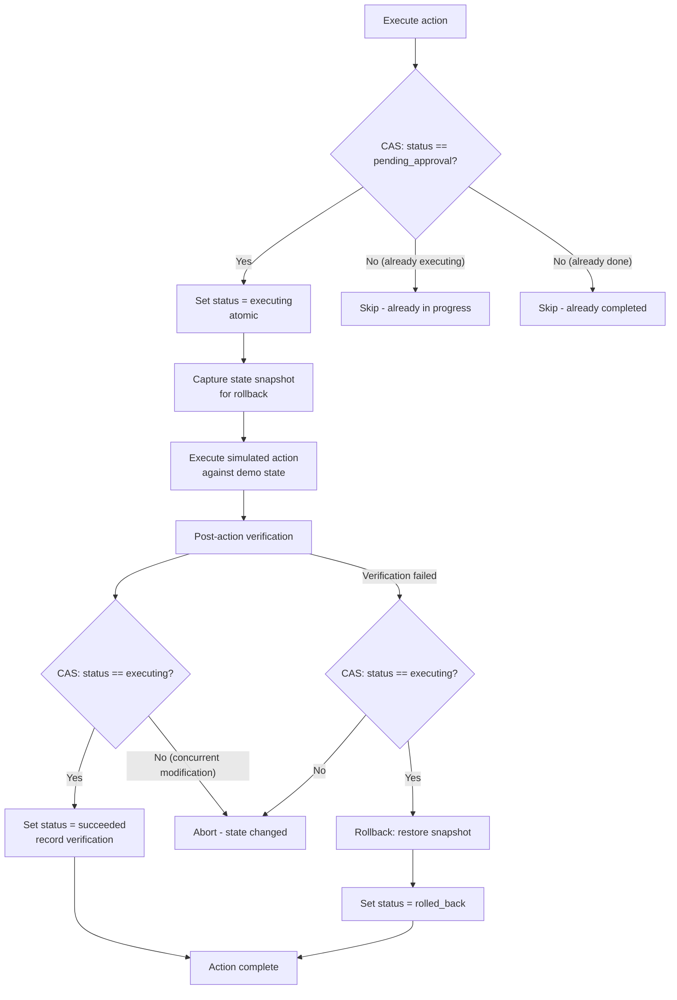

---

## 6. Audit hash chain

```mermaid
flowchart LR
    E1[Event 1<br/>{"action":"login",...}] --> H1["hash_1 = SHA-256<br/>('' + canonical(event_1))"]
    H1 --> E2[Event 2<br/>{"action":"policy_decision",...}]
    E2 --> H2["hash_2 = SHA-256<br/>(hash_1 + canonical(event_2))"]
    H2 --> E3[Event 3<br/>{"action":"approval",...}]
    E3 --> H3["hash_3 = SHA-256<br/>(hash_2 + canonical(event_3))"]
    H3 --> E4[Event 4<br/>{"action":"execution",...}]
    E4 --> H4["hash_4 = SHA-256<br/>(hash_3 + canonical(event_4))"]
    H4 --> E5[Event N<br/>...]
    
    style H1 fill:#e1f5e1
    style H2 fill:#e1f5e1
    style H3 fill:#e1f5e1
    style H4 fill:#e1f5e1
```

```mermaid
flowchart TD
    Verify[Verify hash chain] --> Read[Read all events<br/>ORDER BY sequence ASC]
    Read --> Loop{For each event}
    Loop --> Compute[Recompute:<br/>expected = SHA-256<br/>(prev_hash + canonical(event))]
    Compute --> Compare{expected == stored_hash?}
    Compare -->|"Yes"| Next[Next event]
    Next --> Loop
    Compare -->|"No"| Invalid["CHAIN INVALID<br/>at event #N<br/>tampering detected"]
    Loop -->|"All match"| Valid["CHAIN VALID<br/>all events verified"]
    
    style Valid fill:#e1f5e1
    style Invalid fill:#fde1e1
```

### Database-level append-only enforcement

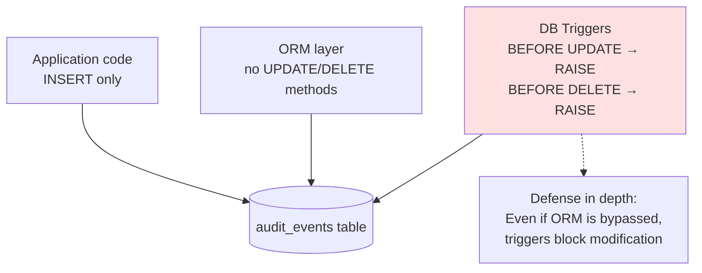

---

## 7. Authentication & authorization flow

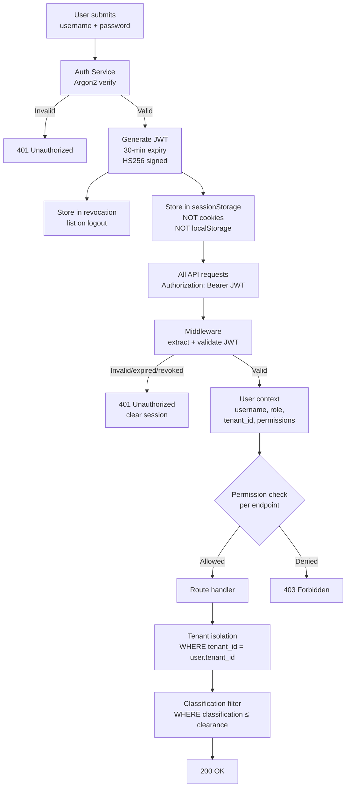

### RBAC decision matrix

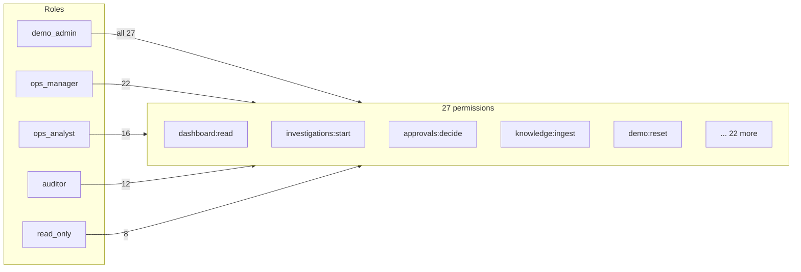

---

## 8. Evaluation & release gate

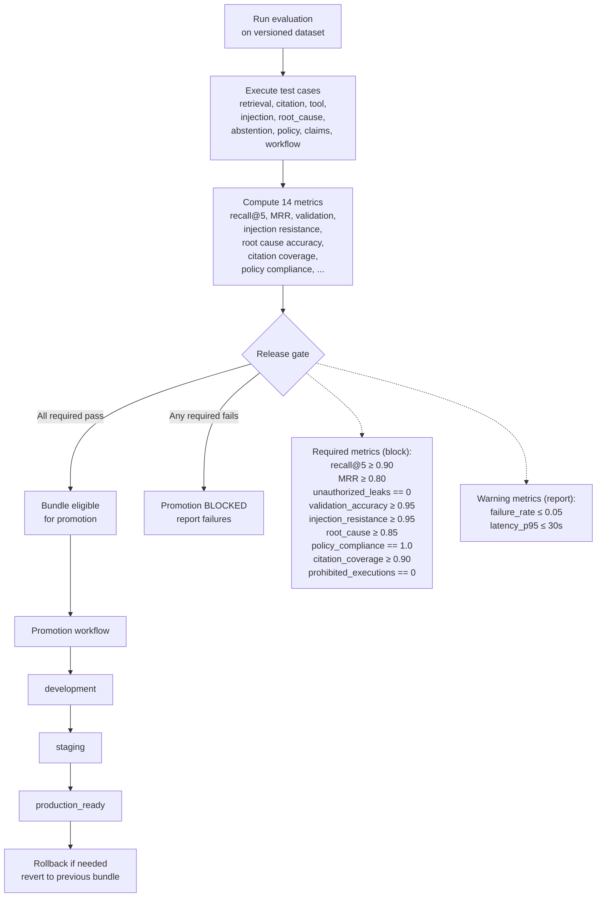

---

## 9. Data model (ERD)

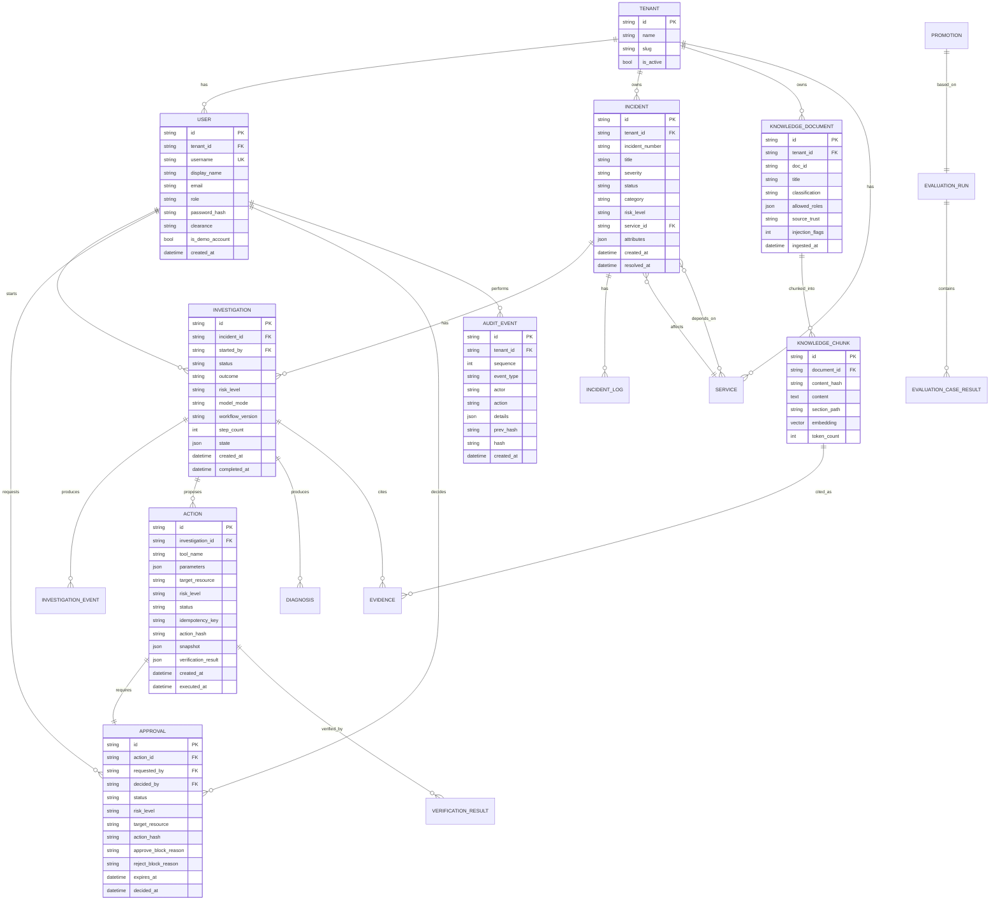

---

## 10. Deployment topology

### Local development (current setup)

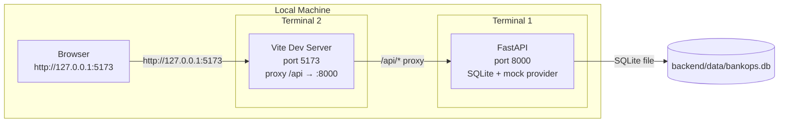

### Docker Compose (production-like)

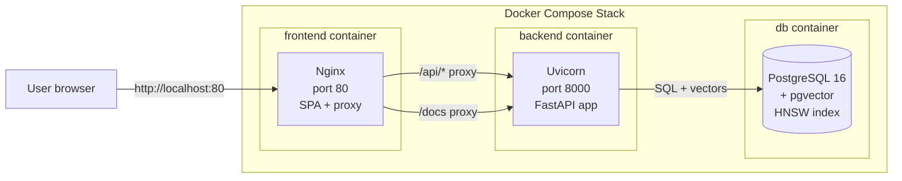

### Vercel + separate backend (cloud)

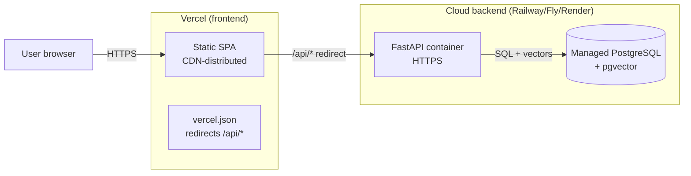
